# Infraestructura - DHCP, SNMP y monitoreo con Zabbix

## Video demostrativo

[Ver video en YouTube](https://www.youtube.com/watch?v=_1fdTzt4Xn0)

## Propósito del laboratorio

Configurar un router Cisco (R1) y un switch Cisco (SW1) con direccionamiento IP, un servidor DHCP para la LAN de clientes, y SNMP de solo lectura. Un cliente Linux (Kali) obtiene su IP por DHCP y se utiliza un servidor Zabbix en esa misma LAN para verificar que los datos SNMP de R1 y SW1 se recolectan correctamente.

## Topología

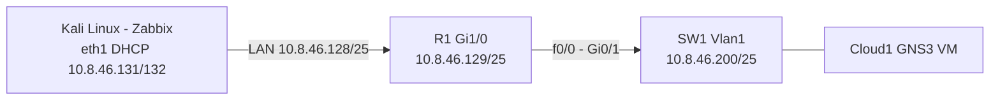

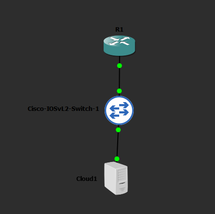

## Plan de direccionamiento

Base 10.8.46.0 (matrícula 20250846).

| Equipo | Interfaz | IP | Función |
|---|---|---|---|
| R1 | GigabitEthernet1/0 | 10.8.46.129/25 | Gateway LAN y servidor DHCP |
| R1 | FastEthernet0/0 | 10.8.46.1/29 | Enlace de gestión hacia SW1 |
| SW1 | Vlan1 | 10.8.46.200/25 | Gestión SNMP |
| Kali | eth1 | DHCP (10.8.46.128/25) | Cliente DHCP y servidor Zabbix |
| Pool DHCP | LAN_CLIENTES | 10.8.46.130 - 10.8.46.254 | Excluidos: 10.8.46.129 |

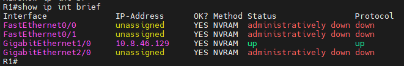

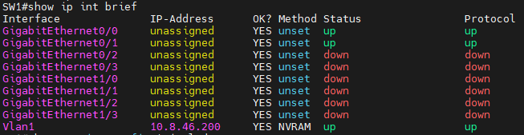

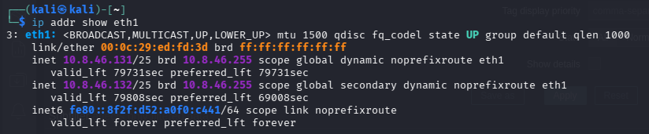

## Servidor DHCP en R1

El pool `LAN_CLIENTES` entrega direcciones a la LAN 10.8.46.128/25, con gateway 10.8.46.129 y la IP del gateway excluida.

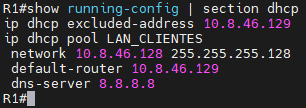

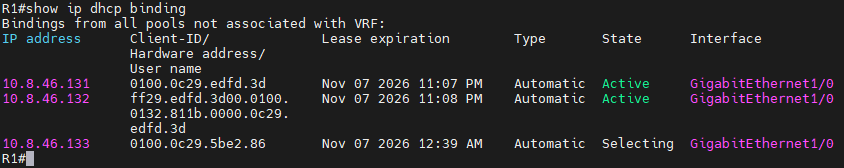

Configuración aplicada: [`scripts/R1_dhcp_snmp.txt`](scripts/R1_dhcp_snmp.txt)

## SNMP de solo lectura

Comunidad `PUBLIC_LAB` con permiso RO en R1 y SW1. Ambos equipos responden a consultas SNMP v2c desde Kali.

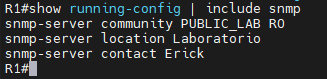

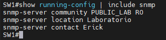

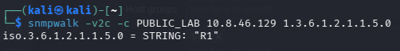

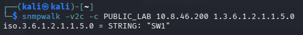

Configuración aplicada: [`scripts/SW1_snmp.txt`](scripts/SW1_snmp.txt)

## Monitoreo con Zabbix

Zabbix 7.0 instalado en Kali (servidor, frontend Apache y agente). Los hosts R1 y SW1 se agregaron con interfaz SNMPv2, comunidad `PUBLIC_LAB` y plantillas de Cisco.

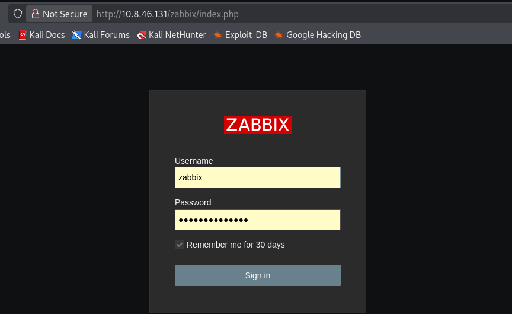

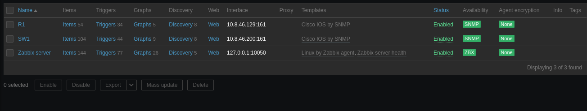

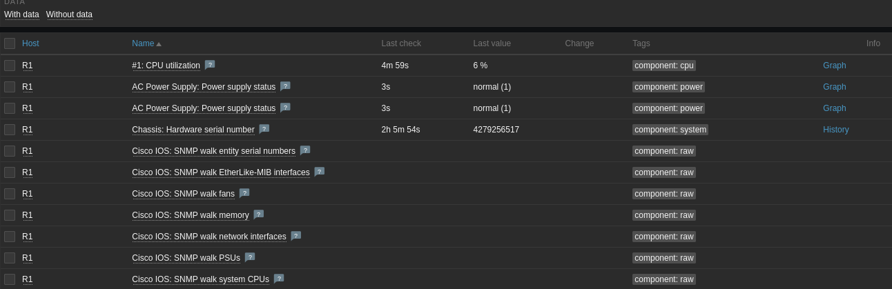

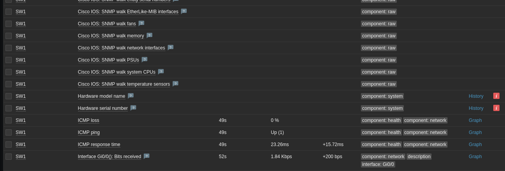

Instalación: [`scripts/zabbix_install.txt`](scripts/zabbix_install.txt). Validación de red desde Kali: [`scripts/kali_dhcp_snmp_check.sh`](scripts/kali_dhcp_snmp_check.sh).

## Running-configs

- [`configs/R1_running.txt`](configs/R1_running.txt)
- [`configs/SW1_running.txt`](configs/SW1_running.txt)
